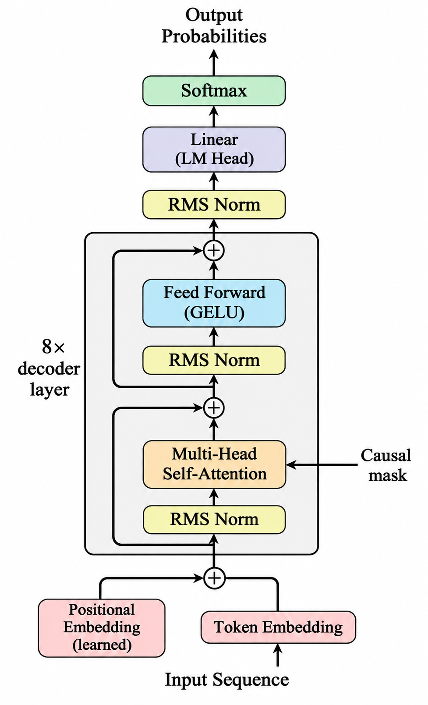
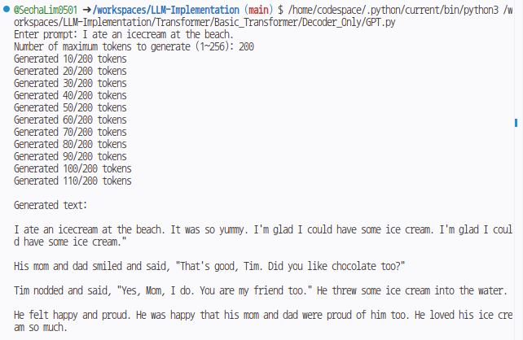
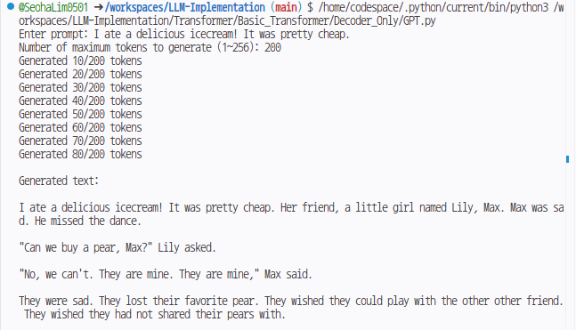
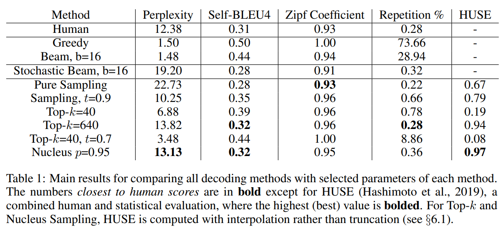
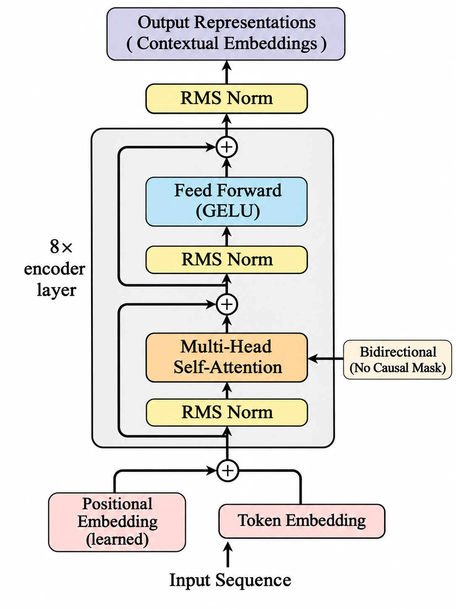
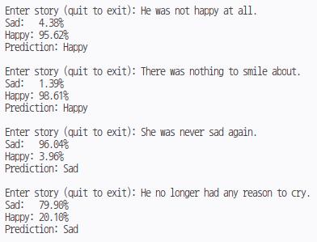
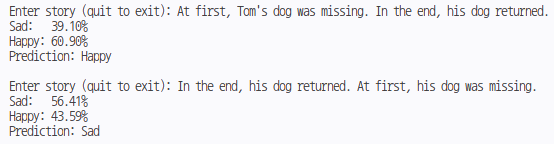
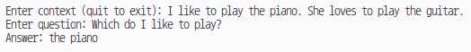
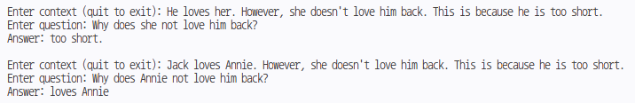
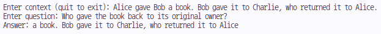

# LLM-Implementation
Use the following code in the terminal in order to install dependencies.
```bash
python pip install -r requirements.txt
```
---
## Transformer Based Large Language Models
### Decoder-Only Model: GPT
For GPT, I used the architecture below for implementation.

All tokenizer, and decoder are trained with dataset 'roneneldan/TinyStories'. As a result, trained model tends to generate kid-like stories, which significantly lacks variety.

A significant problem arises here. Same sentence tends to repeat quite frequently. At the picture above, 'I'm glad I could have some ice cream.' repeats twice.

A small variance of input only resulted in a bigger flaw. The generated extended story was out-of-context and we can see repetitive sentence once again: 'They are mine.' is repeated twice.

**This unexpected behaviour may be caused by Greedy Decoding.** A work by Holtzman et al., *The Curious Case of Neural Text Degeneration* supports this statement.  

It also states that "Our results show that (1) maximization is an inappropriate decoding objective for openended text generation, (2) the probability distributions of the best current language models have an unreliable tail which needs to be truncated during generation and (3) Nucleus Sampling is currently the best available decoding strategy for generating long-form text that is both high-quality — as measured by human evaluation — and as diverse as human-written text."  
In this paper, it suggests that top-p method can resolve this issue, and it is actually used widely throughout studies about large language models.

### Encoder-Only Model: BERT
For BERT, I used the below architecture for implementation.

There are three possible heads for BERT, which are MLM head, QA head and Sentimental head.  
(1) MLM head: It finds the best word to fill in the blank.  
    (ex) I want to `<mask>` apple. -Answer: eat
(2) Sentimental head: It finds whether the input sentence is positive or negative.
    (ex) I had a great day today. -Answer: Happy
    (ex) He fought with his brother today. -Answer: Sad
(3) QA head: It finds the answer of the given question from the given context.
    (ex) Context: Jack loves Annie because she is beautiful.
    Question: Why does Jack love Annie? -Answer: she is beautiful
Both tokenizer and encoder for MLM are trained by the same dataset with GPT, which was 'roneneldan/TinyStories'. After training MLM, Sentimental head and QA head are fine-tuned by each different datasets. Even though train data for base and fine-tuned model are different, it still works because of the concept **'Transfer Learning'**. Due to lack of computing resources, professional tuning was quite restricted. As a result, severe problems for Sentimental head and QA head arose.

#### Sentimental Head
For the Sentimental head, two problems are observed.
- Lexical Bias: Model highly relied on emotional words such as 'happy', 'sad', 'cry'. This is due to **shortcut learning**, the phenomenon which the model highly relies on statistical correlation instead of learning the meaning of sentences. Experimental result is shown below.

Acutally, the work by Robert Geirhos et al., *Shortcut Learning in Deep Neural Networks* states that "The widely used language model BERT has been found to rely on superficial cue words. For instance, it learned that within a dataset of natural language arguments, detecting the presence of “not” was sufficient to perform above chance in finding the correct line of argumentation. This strategy turned out to be very useful for drawing a conclusion without understanding the content of a sentence." This shortcut learning has always been a huge problem. 
- Recency Bias: he classification result is disproportionately influenced by the latter part of the input sequence, particularly the final sentence. This is a kind of **Positional Bias**. Experimental result is shown below. To remove the influence of lexical bias, sentences are composed of non-emotional words.

This positional bias has been deeply studied by Nelson F. Liu et al., with the work *Lost in the Middle: How Language Models Use Long Contexts*. It states that the beginning part and end part of the sentence are used more importantly than tokens in the middle.

#### QA Head
QA Head; Question-Answer head needed bigger model size and more learning time. I used 'rajpurkar/squad' for the dataset, which consists of SQuAD(Stanford Question Answering Database), which was quite different from the training dataset for both MLM head and tokenizer. Objective of this differ between pre-trained model and fine-tuned model is to experiment about transfer learning, which did not quite fit well. However, the model was enough to answer simple questions.

Some crucial problem of this model was that the model didn't understand the context, but it only relied on combinations of tokens.

In the figure above, only replacing 'she' and 'he' to name made the sentence incomprehensive for the model. This is because the model didn't know how words 'she' and 'he' can replace names. Another fail case is provided below.

This is the case where the model did find the answer which contained the real answer, but didn't find the shortest specific range of where the answer is.

### Encoder-Decoder Model